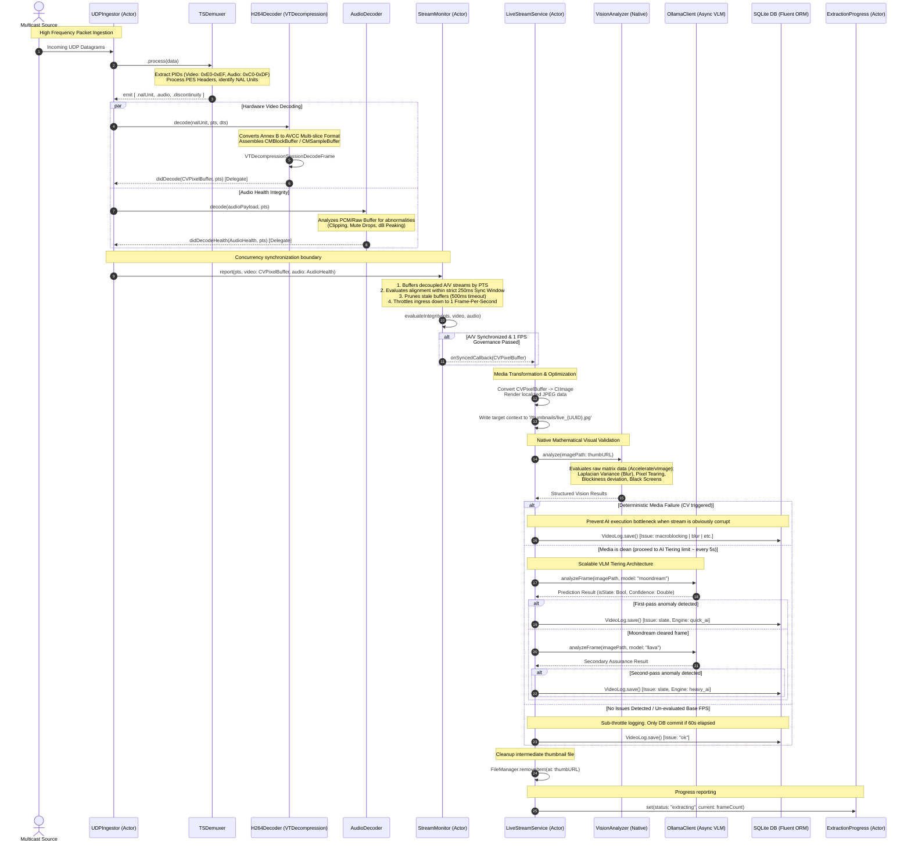

# Eyes on Glass: Signal Flow Analysis

This document illustrates the highly detailed end-to-end signal flow of the Eyes on Glass Swift backend media pipeline. It traces the journey of a livestream from the moment it is ingested as a UDP multicast packet down to the point where AI analytics results are recorded into the database.

## System Architecture

The pipeline demonstrates a native zero-copy mechanism bypassing standard sub-processes (like `ffmpeg`) to leverage Apple Silicon heavily across Swift actors, AudioToolbox, and native Vision models.

### End-to-End Evaluation Sequence

## Component Roles & Responsibilities

- **`UDPIngestor`**: Native actor wrapping lightweight `NWConnection` equivalents via BSD Sockets handling high-frequency datagram payloads continuously.
- **`TSDemuxer`**: Responsible for the byte-level parsing of MPEG-TS formatting, tracking structural continuity counters, preventing packet fragmentation errors, and extracting precise Annex-B blocks.
- **`H264Decoder`**: Low-level CoreMedia bridge routing synchronized IDR/Non-IDR frames into the isolated Apple Silicon hardware `VTDecompressionSession`.
- **`StreamMonitor`**: Time-governing actor mapping separate Video tracking items alongside decoupled Audio buffers to perform temporal validation over drifting streams.
- **`LiveStreamService`**: The macro orchestrator translating clean CVPixelBuffer hardware frames into HTTP boundary-compliant tests, logging metrics down to the database asynchronously.
- **`VisionAnalyzer`**: Natively optimized framework assessing spatial and standard-deviation differences instantly. 
- **`OllamaClient`**: A locally orchestrated abstraction layer executing fast inference against Vision Language Models dynamically based on the severity and confidence required.
